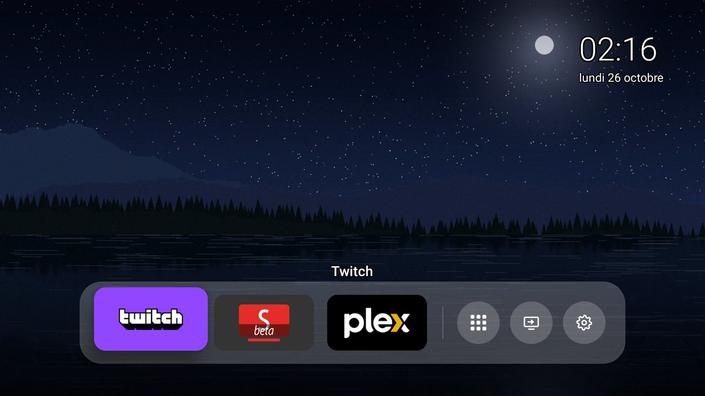
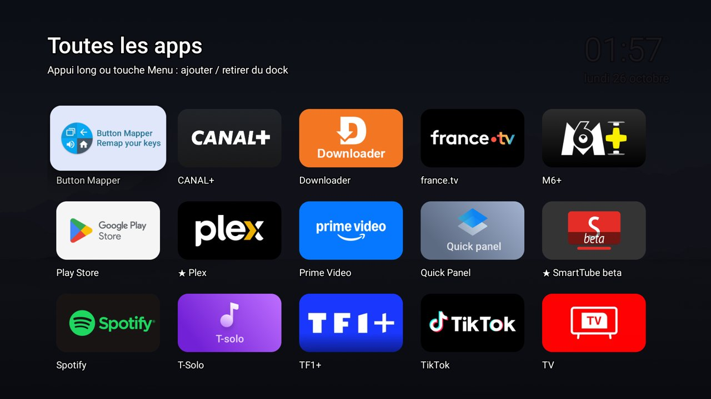
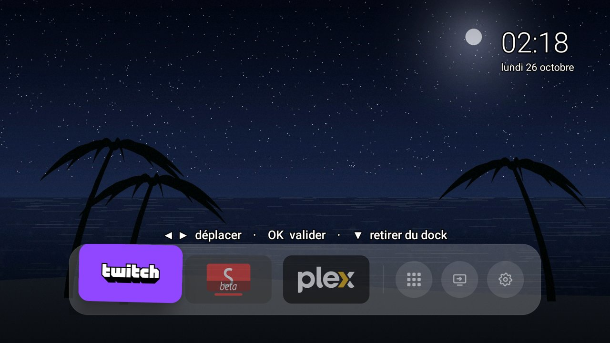
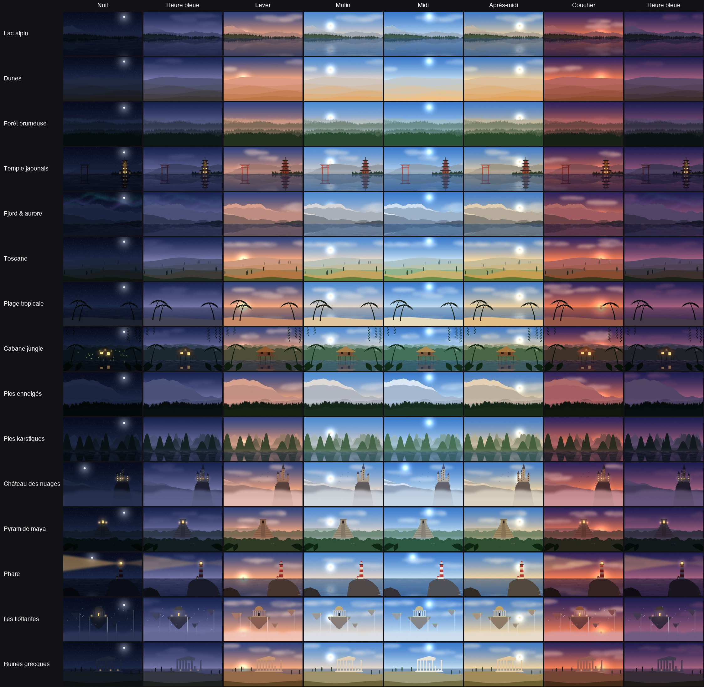

# Zen TV

**Rends ton Android TV / Google TV rapide, épurée et sans pub, en quelques clics et de façon 100 % réversible.**

🇬🇧 [Read in English](README.md)



Zen TV fait deux choses :

1. **Allège la télé** : coupe les pubs du fabricant, la télémétrie et les applis préinstallées inutiles.
   Il **te demande d'abord** pour tout ce que tu pourrais utiliser (Chromecast, assistant vocal, lecteur USB…).
2. **Installe Zen Home** : un écran d'accueil minimaliste façon Apple TV, avec un dock de tes applis préférées
   et des fonds d'écran nature vivants qui suivent l'heure réelle (aube, midi, coucher du soleil, nuit…).

**Rien n'est jamais désinstallé.** Les applis sont seulement *désactivées*, une sauvegarde est faite avant
toute modification, et une option du menu remet la télé exactement comme avant.

## Ce qu'il te faut

- Une Android TV ou Google TV (TCL, Sony, Philips, Hisense, Xiaomi, Chromecast avec Google TV, Nvidia Shield…)
- Un ordinateur (Windows, Mac ou Linux) **sur le même Wi-Fi / réseau** que la télé
- 10 minutes

## Étape 1 — Activer le débogage sur la télé (une seule fois)

1. Sur la télé : **Paramètres → Système → À propos** (parfois *Préférences de l'appareil → À propos*).
2. Clique **7 fois** sur **Build de l'OS Android TV** (ou *Build*) jusqu'au message *Vous êtes développeur*.
3. Reviens dans **Paramètres → Système → Options pour les développeurs** et active **Débogage USB**
   (et **Débogage réseau** / **Débogage sans fil** s'il existe).

## Étape 2 — Télécharger Zen TV

Télécharge **`zen-tv.zip`** depuis la [dernière version](https://github.com/Hoax017/zen-tv/releases/latest)
et dézippe-le où tu veux.

## Étape 3 — Lancer

| Windows | Mac | Linux |
|---|---|---|
| Double-clic sur **`zen.bat`** | Ouvre *Terminal*, tape `cd ` (avec un espace), glisse le dossier dézippé dans la fenêtre, Entrée, puis tape `./zen.sh` | Dans un terminal, dans le dossier : `./zen.sh` |

Ensuite, suis le menu :

```
  1) Back up the TV            → sauvegarder (fait automatiquement avant tout changement)
  2) Clean up                  → alléger : pubs, télémétrie, applis inutiles (demande pour chaque fonction)
  3) Install the Zen Home screen → installer l'écran d'accueil Zen Home
  4) Re-apply after a TV update → réappliquer après une mise à jour de la télé
  5) Restore the TV            → tout remettre comme avant
  6) Take a screenshot         → capture d'écran de la télé
  7) Connect to another TV     → changer de télé
```

- La première fois, le script propose de télécharger **adb**, l'outil officiel de connexion Android, directement chez Google.
- Il trouve la télé tout seul sur ton réseau. **Regarde la télé** au moment de la connexion :
  accepte la fenêtre *Autoriser le débogage USB ?* (coche *Toujours autoriser*).

## Zen Home

| | |
|---|---|
|  |  |

- **Dock** : tes applis préférées. **Reste appuyé sur OK** sur une appli pour la déplacer (◀ ▶), la retirer (▼), puis OK.
- **Toutes les apps** (bouton grille) : appui long ou touche *Menu* pour ajouter / retirer une appli du dock.
- Les boutons **Entrées** et **Réglages** sont toujours là.
- **15 paysages × 8 moments de la journée**, mélangés en continu selon le vrai lever et coucher du soleil chez toi
  (d'après le fuseau horaire de la télé) : lac alpin, dunes, forêt brumeuse, temple japonais, fjord et aurore boréale,
  Toscane, plage tropicale, cabane dans la jungle, pics enneigés, pics karstiques, château des nuages,
  pyramide maya, phare, îles flottantes, ruines grecques.



Google TV ne permet pas de changer l'écran d'accueil par défaut. Zen Home inclut donc un mini service
d'accessibilité qui écoute uniquement la touche **Accueil** de la télécommande et ouvre Zen Home. Pour rendre la
touche Accueil à la télé sans ordinateur : **Paramètres → Accessibilité → « Zen Home – touche Accueil » → désactiver**.

## Tout annuler

Lance le script et choisis **5) Restore**. Il réactive toutes les applis qu'il a désactivées, remet tes réglages
d'accessibilité et ton écran d'accueil, et retire Zen Home. Il compare ensuite avec la sauvegarde et te signale
toute différence. (Raccourci Mac/Linux : `./zen.sh --restore` ; Windows : `zen.bat -Restore`.)

Les sauvegardes sont dans le dossier `backups/` à côté du script : **garde ce dossier** pour pouvoir restaurer plus tard.

## C'est sans risque ?

- Les applis sont désactivées avec la commande Android officielle `pm disable-user`, **jamais désinstallées**.
- Une liste de composants système critiques (`profiles/protected.txt`) ne peut jamais être désactivée, même par erreur.
- Les listes de marque *testées* l'ont été sur une vraie télé. Pour les autres marques, seule la liste Google
  générique est utilisée, plus un **scan avancé** optionnel qui demande pour chaque appli du fabricant.
- Au pire, *Restore* remet tout en place, et une réinitialisation d'usine de la télé fonctionne toujours.

| Liste | État |
|---|---|
| Google (toutes les télés) — `profiles/common.txt` | générique |
| TCL — `profiles/tcl.txt` | ✅ testée (TCL G07, Google TV, Android 11) |

**Contributions bienvenues** : testé sur une autre télé ? Ajoute `profiles/<marque>.txt` (la marque telle que
renvoyée par `adb shell getprop ro.product.manufacturer`, en minuscules) et ouvre une pull request.

## Problèmes fréquents

- **Télé introuvable** : vérifie que la télé et l'ordinateur sont sur le même réseau et que le débogage est activé.
  Tu peux aussi taper l'adresse IP de la télé (télé : *Paramètres → Réseau*).
- **« waiting for approval on the TV »** : accepte la fenêtre affichée sur la télé.
- **Android 11+ « Débogage sans fil »** avec code d'appairage : tape l'`IP:port` d'appairage quand c'est demandé, puis le code.
- **Des applis désactivées sont revenues après une mise à jour** : menu **4) Re-apply**.
- **Mac : « No route to host »** : le script redémarre adb tout seul ; si ça persiste, autorise *Terminal* dans
  *Réglages Système → Confidentialité et sécurité → Réseau local*.

## Le compiler soi-même (développeurs)

Il faut : Android SDK (build-tools + une plateforme ≥ 30), JDK 11+, Python 3 avec Pillow.

```bash
pip install pillow
./launcher/build.sh        # → dist/zen-home.apk
./tools/make-release.sh    # → dist/zen-tv.zip
```

Pas de Gradle : `build.sh` appelle directement aapt2, javac, d8 et apksigner. Les fonds d'écran sont générés par
`launcher/tools/gen_wallpapers.py` (Python pur, aucune image de banque d'images).

## Licence

[MIT](LICENSE). Projet indépendant, sans lien avec Google, TCL ni aucun fabricant de télé.
